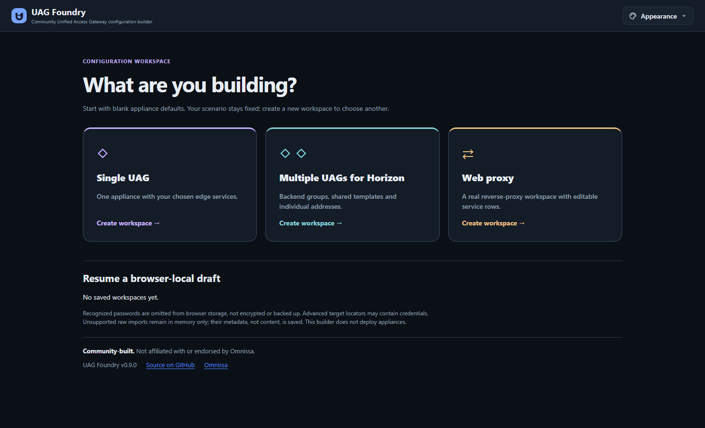
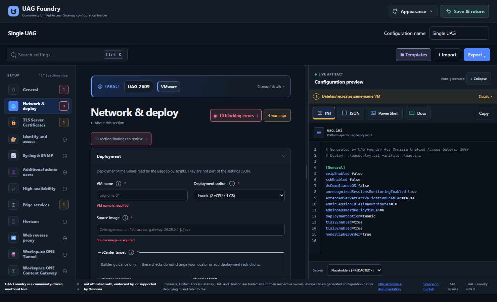

<picture>
  <source media="(prefers-color-scheme: dark)" srcset="assets/uag-studio-readme-icon-dark.png">
  
</picture>

# UAG Studio

Build, check and export configurations for **Omnissa Unified Access Gateway (UAG)**—right in your browser.

## 🚀 Try it

**[Open UAG Studio](https://uagstudio.graa.dev)** — no installation needed.
Your configuration is processed in your browser, not uploaded to a server.

**Moving from UAG Foundry?** Version 0.9.1 uses a new domain. Browser-local drafts and preferences do not automatically transfer; see the [migration notes](docs/technical-guide.md#moving-from-gateway-forge) before switching.

*UAG Studio 0.9.1 with the layered workspace and gateway mark. The saved Single UAG example passes checked-export validation and shows **Ready to export**; this is not live deployment or security certification. Screenshots use a disposable browser profile and blank or synthetic configurations, not operator drafts.*

*Configuration fields come first. Compact readiness and advisory counts stay above them; select a count to open the full **Validation & lint** panel below the section.*

## 🏠 Self-hosting

Prefer your own instance? Run UAG Studio with Docker or Podman, or host it on your own web server. See the [container instructions](docs/technical-guide.md#containers) and [hosting notes](docs/technical-guide.md#hosting).

## 🧭 How it works

1. **Start a configuration.** Begin blank, use a template, or import an existing INI or settings JSON file.
2. **Make it yours.** Choose your deployment platform and UAG version, then fill in the settings you need. Use the compact counts to review validation below the section, then click a finding to jump to its field.
3. **Review and export.** Download deployment files, settings JSON or PowerShell commands. Run the appropriate deployment tools yourself—the app does not deploy anything.

Browser-local drafts let you return to your work. Deployment image and certificate paths refer to files on your deployment host, not browser uploads.

### ✨ Configuration workspaces

Choose **Single UAG**, **Horizon UAG topology** or **Web proxy**. Named browser-local drafts keep configurations separate and show **Ready to export** or **Needs fixes**, with advisory warnings separate from blockers. Single UAG and Web proxy draft names include the configured appliance hostname. Horizon readiness includes topology planning and fleet-level checks; fleets have a group overview and grouped downloads. Choose among three palettes and System, Light or Dark themes. **Save & return** resumes the chooser. Remove one draft or use confirmed **Clear all drafts** without resetting appearance or the previous legacy configuration. Read the [workspace details](docs/technical-guide.md#scenario-workspaces) or see the [roadmap](ROADMAP.md) for future work.

### 🗺️ Horizon fleet workflow

A Horizon workspace manages multiple UAG configurations together. **UAG groups** share a configuration template and Connection Server destination, while each appliance retains its own name and IP addresses. A group is a Studio configuration grouping—not an automatically discovered Horizon pod or site.

1. **Prepare the first UAG.** Fill in or import the Horizon baseline and resolve blocking validation findings. Select **Continue to fleet topology** to start the plan; this does not deploy anything.
2. **Build your groups.** Add UAGs to a group or create another group for a different shared configuration. New appliance addresses stay blank for you to assign, and new groups do not inherit another group's network settings.
3. **Review shared and individual settings.** Edit the group's template and Connection Server URL for shared changes. Use an explicit individual destination override where needed, or open the **Full UAG configuration editor** for all appliance settings.
4. **Check the overview.** See clients, groups, configured destinations and supported UAG High Availability VIPs. Dotted hypothetical load-balancer/pool options are visual planning aids only: they do not configure routing, discover servers or change exports. Native UAG HA covers XML API traffic, not all display-protocol traffic.
5. **Resolve blockers and export.** Findings link to the affected UAG and field. **Download fleet configuration** creates a checked ZIP with group folders, appliance INIs, topology metadata and a deployment checklist. Saved-draft readiness includes topology planning and fleet-level checks; warnings alone do not block export. Baseline INI export remains available independently before the topology is planned.
6. **Deploy and verify separately.** Review secret handling, supply credentials securely and run the deployment tools yourself. Studio does not verify live reachability, certificates, Horizon sessions or failover. Removing a UAG from the plan does not remove a deployed VM.

See the [detailed fleet behavior and limitations](docs/scenario-workspaces.md#shared-versus-individual) and [Horizon Architecture](https://techzone.omnissa.com/resource/horizon-8-architecture).

## ⚠️ Before you deploy

- **Deployment scripts can delete and recreate an existing VM.** Confirm the target and VM name, back up your configuration and plan downtime.
- **Keep drafts and exports private.** Check the export's secret-handling choice; imported values and advanced locators can still contain credentials. Browser drafts are not a secure secrets store.
- **Test in a lab first.** Generated files and automated checks do not certify every platform, service or HA/failover setup. See the [support and test status](docs/technical-guide.md#deployment-support-and-test-status).

## 💡 Ideas and feedback

Feature suggestions are welcome! [Open an issue](https://github.com/erikgraa/uag-studio/issues) with what you'd like to do and how it would help. Feedback and contributions are welcome too.

## 📚 More information

- [Technical guide](docs/technical-guide.md) — platform notes, deployment steps, file formats, security, Docker and local development.
- [Source references](SOURCES.md) — where supported settings and evidence come from.
- [Roadmap](ROADMAP.md) · [Changelog](CHANGELOG.md) · [Contributing](CONTRIBUTING.md)

## 📄 License and disclaimer

[MIT](LICENSE). UAG Studio is an independent community tool, not affiliated with or endorsed by Omnissa. Always review generated configuration before deploying to production.
