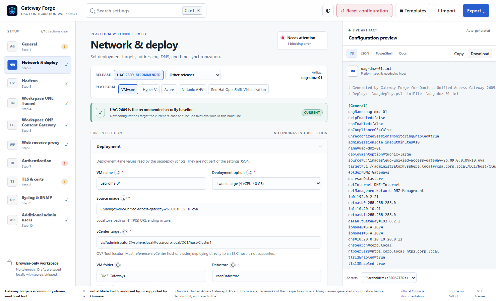
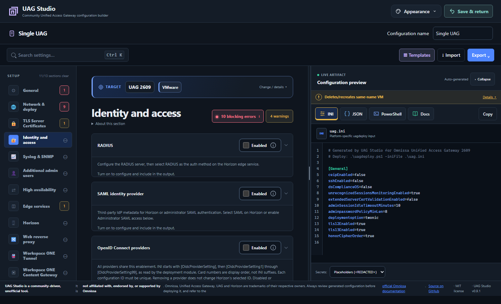
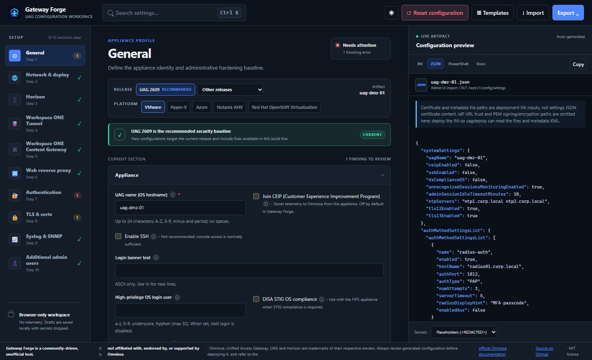
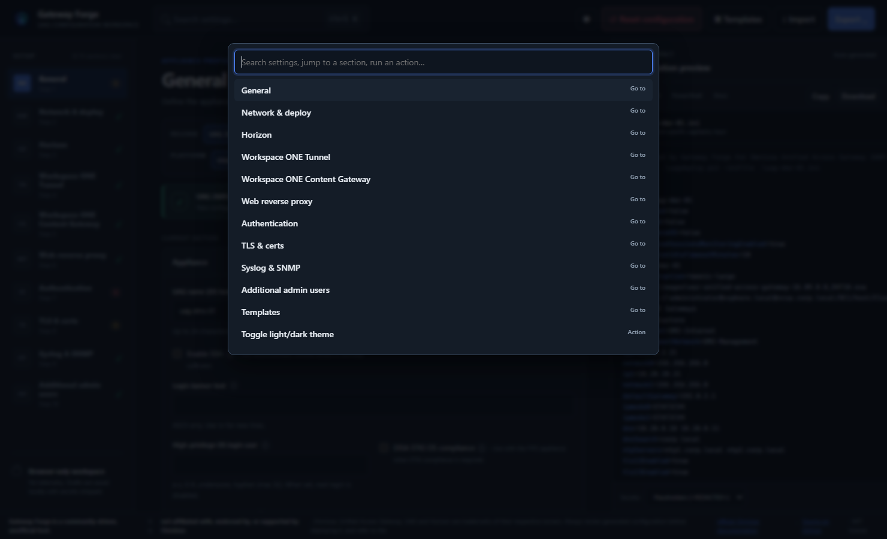
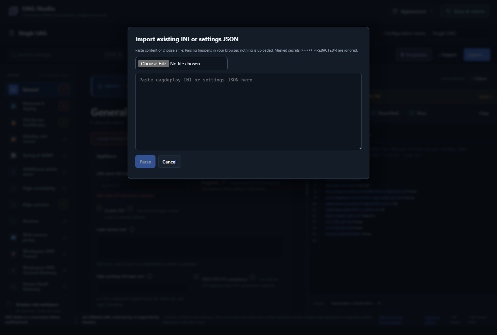

# UAG Studio technical guide

Configuration coverage, deployment prerequisites, file formats, support evidence,
privacy, development and hosting. For a quick introduction, see the [README](../README.md).

## Contents

- [Scenario workspaces](#scenario-workspaces)
- [Moving from Gateway Forge](#moving-from-gateway-forge)
- [Configuration coverage](#configuration-coverage)
- [Supported UAG versions](#supported-uag-versions)
- [Deployment support and test status](#deployment-support-and-test-status)
- [Configuration and deployment workflow](#configuration-and-deployment-workflow)
- [Source evidence](#source-evidence)
- [Settings JSON boundaries](#settings-json-boundaries)
- [Security and privacy](#security-and-privacy)
- [Containers](#containers)
- [Development](#development)
- [Hosting](#hosting)
- [UAG Studio releases](#uag-studio-releases)

## Scenario workspaces

The source workspace now starts with **Single UAG**, **Horizon UAG topology**, or **Web proxy**. Each named configuration keeps its scenario. **Save & return** preserves it and opens the chooser; only the scenario cards create new workspaces. Selecting the brand uses the same save-and-return action. Editors are native Svelte components, not embedded review bundles. Original palette + System theme is the default; Harbor/Warm slate and explicit Light/Dark are independent preferences.

Browser-local workspaces use `gateway-forge.workspaces.v1` and appearance uses `gateway-forge.appearance.v1`. The previous `gateway-forge.draft` remains unchanged and explicitly resumable as a Single configuration. Unsupported registries are never overwritten. Recognized passwords are omitted, not encrypted; credential-bearing advanced target locators remain exact and can contain secrets. Unsupported/raw imports stay in memory only, with metadata saved rather than unredactable content.

Horizon starts with one genuinely blank/default appliance and the Horizon service selected—not seeded deployment values. Fill or import a configuration that passes validation before unlocking topology and using it as the shared baseline. UAG groups retain shared template snapshots, independent member counts and individual names/addresses/destination overrides. Removal excludes appliances from exports; Undo restores their configuration. Checked fleet ZIPs contain one safe deterministic folder per group, member INIs linked by `topology.json`, and a short `README.txt` deployment checklist. Compatible earlier topology review manifests remain importable. Static NIC/subnet/collision and native HA checks do **not** certify infrastructure, certificates, L2 connectivity or live failover; deployment stays manual. See the [scenario implementation notes](scenario-workspaces.md) for architecture and detailed preservation boundaries.

Ordinary schema-identified single-line text trims **trailing** whitespace on blur and saved/exported snapshots, not each keystroke. Leading/internal spaces, passwords, multiline/raw content, custom overrides and untouched advanced locators retain their spelling.

**Azure/TLS evidence scope:** inspected supplied vendor INI samples and Azure deployment script behavior, not an agent-run Azure deployment. `[General] honorCipherOrder` defaults to true, preserves explicit false, and is INI-only because a supported settings-JSON mapping was not established. Azure NIC0/1/2 subnet names are required for the applicable one/two/three-NIC builder layout as a **Studio safety policy**; the supplied script otherwise defaults a missing subnet to the first VNet subnet. NSGs are optional. NIC0 public IP uses an existing **resource name**, not a literal address; its optional resource group is emitted only with that name and otherwise falls back to the VM deployment resource group. The optional virtual-network resource group is ungated and uses the same blank fallback. No fresh `isVNetInDifferentResourceGroup` toggle is generated because the inspected scripts do not read it; imported compatibility data remains retained. Newly recognized legacy INI extras are promoted before defaults, preserving explicit values and unknown entries.

The chooser supports confirmed removal of one draft or **Clear all drafts**, including fleet plans and memory-only imports. The bulk confirmation shows the count; Cancel, Escape or a failed storage write preserves all drafts. Appearance, the legacy configuration and unrelated storage remain unchanged. Unsupported physical registries are protected even when session-only drafts are cleared.

## Moving from Gateway Forge

Version 0.9.0 introduced UAG Foundry at `https://uagfoundry.graa.dev/`. Version 0.9.1 adopts UAG Studio at `https://uagstudio.graa.dev/`. The repository is now `erikgraa/uag-studio` and the npm package identifier is `uag-studio`; this repository/package alignment does not change the app version. GitHub redirects the previous `gateway-forge` and `uag-foundry` repository URLs; this does not rename existing GHCR packages or migrate browser storage.

**Before switching domains**, export each configuration you need from the old origin and keep the files private. Checked exports require resolving blockers first. If a draft cannot be exported, preserve its old-origin browser storage privately before making changes and retain the original browser profile. Import its INI or settings JSON in a new workspace on the new site. Export a Horizon fleet bundle to transfer compatible topology. These files are configuration transfers, not complete browser-profile backups: workspace IDs/names, Undo history, appearance, omitted passwords and unsupported memory-only imports do not move automatically. Review the export secret policy and save original unsupported import files separately. Re-select appearance and supply credentials securely at the new origin. Browser data on the old origin is not deleted by this release, but cannot be read from the new domain. Same-origin upgrades retain existing storage keys and supported topology formats.

## Configuration coverage

- 📄 **INI for `uagdeploy.ps1`** (the primary deploy path - the script takes an INI via `-iniFile`, not JSON) **and settings JSON** for the admin UI *Import settings* / `PUT /rest/v1/config/settings`.
- 💻 **Platform-aware deployment output** for vSphere, Hyper-V, Azure and Nutanix AHV. Nutanix generates the documented `[Nutanix]` INI and `uagdeployntnx.ps1` invocation for a QCOW2 image uploaded to Prism Central.
- ☸️ **Red Hat OpenShift Virtualization (Limited Availability):** generates the documented CDI `DataVolume` + `DataSource` YAML for a cluster-reachable QCOW2 URL, the `[OpenShift]` INI, `oc` preparation/verification commands and `uagdeployopenshift.ps1` invocation. A local QCOW2 uses explicit console-upload runbook mode rather than an invalid fake manifest.
- 🧬 **Version-aware form** driven by a data-driven schema ([`src/lib/schema.ts`](../src/lib/schema.ts)): fields appear/disappear per UAG version and platform.
- 🎯 **Scope:** Horizon, Workspace ONE Tunnel, Workspace ONE Content Gateway and Web Reverse Proxy edge services; RADIUS, SAML, OpenID Connect, RSA SecurID and certificate authentication; TLS protocols/ciphers/certificates, outbound proxy, syslog (UDP/TCP/TLS/MQTT) and SNMP (v1/v2c/v3). Platforms: vSphere, Hyper-V, Azure, Nutanix AHV and Red Hat OpenShift Virtualization. OIDC, SecurID, certificate auth and outbound proxy are emitted to the INI only (their JSON shape is not documented).
- 🪜 **Cascading (double DMZ):** pick *Outer UAG* or *Inner UAG* under Horizon. The outer UAG is generated as a Horizon-WRP reverse proxy (documented proxy pattern, inner UAG URL/thumbprint) plus optional forwardrules for Blast/UDP tunnel/PCoIP; the inner UAG is a standard Horizon edge. Two ready-made templates are included. (Workspace ONE Tunnel cascade mode is not covered.)
- 📥 **Import** an existing INI or settings JSON (paste or file) with a preview of what was recognised/ignored; the UAG version is detected from the image file name.
- ✅ **Validation + best-practice lint** (required fields, IPv4/URL/port/thumbprint formats, RADIUS timing, duplicate IPs, unique DNS/NTP lists and distinct fallback NTP servers (without removing imported values), advisory single-server DNS/NTP warnings (NTP counts primary and fallback lists together; multiple addresses do not guarantee independent redundancy), TLS 1.0/1.1, SSH, missing syslog/NTP, SHA-1 thumbprints …). Click a finding to jump to the field. The full **Validation & lint** panel sits below the current section's fields; compact counts and inline errors remain above and alongside them. Blocking-error, advisory/warning and section-count buttons open **Validation & lint**, scroll its containing pane and focus its heading; they also work with Enter/Space and respect reduced motion.
- 🗺️ **Topology diagram** that updates live, 📋 **templates with architecture previews** showing gateway connections, identity providers and monitoring before loading a design, with distinct theme-aware color accents and labeled design bands so cards are recognizable without relying on color (e.g. *Horizon external access with RADIUS MFA*), 📝 **Docs** tab (Markdown runbook summary), ⌨️ **command palette** (<kbd>Ctrl</kbd>/<kbd>⌘</kbd>+<kbd>K</kbd>).
- 📂 **Quieter workspace:** compact **Target** summary with expandable release/platform controls and advice; section descriptions under **About this section**. Configuration groups, live topology, templates and list instances stay open by default. Validation expands for blocking errors; nonblocking lint and PowerShell runtime guidance start collapsed. Destructive-deployment warnings remain visible beside Copy and inside Export, with expandable platform details. The footer stays at the end of the workspace, including narrow layouts; validation navigation does not scroll into blank space beyond it. On phones, the sticky section navigation follows the actual wrapped header height so its count buttons stay unobscured.
- 🌗 **Light/dark theme** - follows `prefers-color-scheme` by default, your choice is remembered.
- **Administrator access:** UAG 2609 `[adminSAMLSettings]` configuration and separate management/Admin UI TLS certificate paths in `[SSLCertAdmin]`.

**Screenshots:** these captures show UAG Studio 0.9.1 with the layered workspace and gateway mark and blank or synthetic configurations. The capture script owns a disposable browser profile and does not use operator drafts.

| Light theme & Networking subsection | Authentication & validation |
| --- | --- |
|  |  |
| **JSON output** | **Command palette** |
|  |  |
| **Import** |
| --- |
|  |

## Supported UAG versions

UAG Studio offers schema targets for releases from UAG 2212 through 2609. Current support status still depends on the [Omnissa Lifecycle Matrix](https://docs.omnissa.com/bundle/Product-Lifecycle-Matrix/page/lifecyclematrix.html) and the product with which that UAG release is integrated; older releases remain available for migration and maintenance, but may no longer be supported (snapshot **2026-10-30**):

`2212 · 2303 · 2306 · 2309 · 2312 · 2406 · 2412 · 2503 · 2506 · 2512 · 2603 · 2606 · 2609`

2209 and older are no longer listed and are intentionally not offered. The list lives in [`src/lib/versions.ts`](../src/lib/versions.ts) - update it when the matrix changes. Maintenance releases (e.g. `2509.1`) use the schema of their parent release.

Per-version field availability (`since` in the schema) was derived by diffing the published *Deploying and Configuring UAG* INI/Horizon reference pages of each release (2212 → 2609), e.g. `headersToBeLogged`/`minSHAHashSize` (2312), `enableAuthOnRedirectedSite`/`unrecognizedSessionsMonitoringEnabled` (2406), additional Blast/Tunnel external URLs and `disableWebClient` (2412), `originCheckEnabled` (2503), SAML IdP binding keys (2603). Treat gating as best-effort: Omnissa's pages reorganised over time, so a key may exist slightly earlier than the page first lists it.

The completed [UAG 2609 Horizon schema audit](horizon-2609-schema-audit.md) records every documented Horizon row, the schema decision, exact type/default/version gate where known, and explicit exclusions or uncertainty. It was audited on **2026-11-08**.

## Deployment support and test status

**Hyper-V builder support:** host filesystem storage paths, local `.vhdx` images and optional per-NIC access VLAN output are implemented for one-, two- and three-NIC layouts. VLANs use guarded post-deployment PowerShell; they are not vendor INI/settings JSON settings. Implemented support is recorded in [#139](https://github.com/erikgraa/uag-studio/issues/139), closed as completed. This does not certify every package/version, live generated-VLAN execution or untested service; the scoped operator deployment evidence below remains the support boundary.

| Platform / service | UAG / deployment tooling | Evidence and scope |
| --- | --- | --- |
| vSphere / Horizon | UAG 2609 / OVF Tool 5.0 | Operator-tested INI deployment and Horizon settings application: default passthrough with `authMethods` omitted, and explicit `certificate-auth` with X.509 configured. Credentialed target syntax was confirmed with OVF Tool 5.0. |
| Hyper-V / service not specified | Release and tooling details not supplied | Operator reports settings applied and manually assigned Internet, Management and Backend VLANs to three VM adapters sharing one virtual switch with a trunk-capable uplink. The exact settings list and vendor-created adapter identities were not supplied; agent-run Hyper-V deployments and live validation of generated VLAN PowerShell remain absent. |

**Still untested:** Admin UI SAML authentication, Workspace ONE Content Gateway, and Workspace ONE Tunnel. Configuration generation and automated tests do not establish live deployment or service coverage for these features; the Horizon and scoped Hyper-V reports above do not cover them.

The operator reported regressions with OVF Tool **5.1 and 9.1**. Their causes and affected configurations have not been independently verified; do not infer compatibility merely from a newer version number. This records deployment/settings evidence, not certification of every Horizon authentication workflow or end-to-end client session. The Hyper-V report above is separate, scoped operator evidence, not platform-wide certification. Other platform/service combinations remain unverified unless separately recorded.

### Native high availability configuration

The optional **High availability** section before Edge services configures this UAG's `[HighAvailability]` `groupId` (integer **1–255**) and `virtualIPAddress` (IPv4 only). Both start empty; disabling HA retains values but excludes the section from output. UAGs in the same HA group must use the same Group ID and VIP. The VIP must be unique, available, and in the same subnet as **eth0**; use a Group ID unique to that group in the subnet. Studio does not infer DHCP subnets or verify address availability.

Settings JSON maps to `loadBalancerSettings` with `groupID`, `virtualIPAddress` and `loadBalancerMode: "ONEARM"`, as the vendor deployment sample and API schema specify. `DISABLED` imports remain disabled; missing/unsupported modes are reported rather than silently converted. HA is not supported on Azure. The native HA/VIP configuration tracked in [#145](https://github.com/erikgraa/uag-studio/issues/145) is implemented and the issue is closed as completed. This is two-field configuration generation, not automatic multi-node deployment or verified topology, VIP ownership or failover.

### Hyper-V storage and access VLANs

Fresh drafts and templates leave `ds` empty: Hyper-V shows the **VM storage path** example `C:\ClusterStorage\Volume1\uag-name` rather than a seeded VMware datastore. The example is a placeholder, not an exported value. Existing saved/imported/custom values remain untouched, including `vsanDatastore`; clear an old sample manually if it is not your actual storage path.

Source image examples are platform-specific: `C:\images\euc-unified-access-gateway-26.09.0.0-[..].ova` for vSphere and `C:\images\euc-unified-access-gateway-26.09.0.0-[..].vhdx` for Hyper-V. Replace `[..]` with the actual build text in your downloaded filename. Fresh drafts/templates leave the source empty; existing imported or saved paths are not rewritten when switching platforms.

Optional **access VLAN** fields accept integer IDs **1–4094** for the active NIC layout. They are saved in the browser draft and emitted only as guarded post-deployment PowerShell, never as fabricated vendor INI/settings JSON keys. A newly imported configuration without an existing draft does not recover VLANs from those vendor files. Blank fields leave adapters unchanged; hidden VLAN values are retained but not applied.

The generated commands use named vendor-created management/backend adapters and the unique remaining Internet adapter, never enumeration order or vSwitch names. They require an explicit vendor success message, a new running VM identity, the expected adapter count and unambiguous roles before changing anything. The vendor script deletes/recreates a same-name VM. Changed package conventions fail closed. A shared external switch/uplink must carry the selected VLANs; Hyper-V applies host-side access tagging, while separate access-network switches or a single common network are alternatives.

For manual deployment follow-up, these operator-supplied examples use VM `uag` and adapter names: one NIC uses the first command; two NICs use the first two; three NICs use all three. Confirm the VM and adapter names before running them. Unlike the generated output, these standalone commands do not check deployment success or adapter identities.

```powershell
Set-VMNetworkAdapterVlan -VMName "uag" -Access -VMNetworkAdapterName "Network Adapter" -VlanId 10
Set-VMNetworkAdapterVlan -VMName "uag" -Access -VMNetworkAdapterName "Management Network Adapter" -VlanId 20
Set-VMNetworkAdapterVlan -VMName "uag" -Access -VMNetworkAdapterName "Backend Network Adapter" -VlanId 30
```

Generated VLAN PowerShell has **not been tested on a live Hyper-V host**. Vendor deployment must finish before VLAN commands run; DHCP may therefore require a reachable initial/native network. A VLAN cmdlet failure stops subsequent changes but does not roll back earlier changes.

## Configuration and deployment workflow

1. Expand **Target → Change / details** to pick the **UAG version** and **platform** (vSphere, Hyper-V, Azure, Nutanix AHV or OpenShift Virtualization) - or start from a **template**, or **Import** an existing INI/JSON. Nutanix output is available from UAG 2606; OpenShift output is UAG 2609 and Limited Availability.
2. Fill in the sections. Required fields and lint findings are flagged inline and in the *Validation & lint* panel. For **Hyper-V**, **VM storage path** is a filesystem path on the deployment host (for example `C:\ClusterStorage\Volume1\uag-name`), exported under the unchanged `ds` INI key.
3. Take the result from the right-hand panel: **INI**, **JSON**, **PowerShell** or **Docs**; *Copy* or *Download* (also in **Export**). The desktop output pane has a little extra width; **Collapse** reduces it to an **Output** tab at the side, reopening without changing your configuration, selected format or preview scroll position. On narrower layouts it collapses to a compact bar below the form instead. Collapse is a temporary view choice; reloading starts expanded. INI, JSON and PowerShell previews show a muted line-number gutter aligned to logical lines, with horizontal scrolling for long lines. Line numbers are display-only: selection, copying and downloads retain the original artifact text. PowerShell deployment/password guidance uses short comment lines and spacing between topics, including in copied/downloaded scripts; executable commands and embedded configuration are not wrapped.
4. Deploy with the command shown for the selected platform. Every variant explicitly passes `-iniFile <config-file>`: vSphere `.\uagdeploy.ps1`, Hyper-V `.\uagdeployhv.ps1`, Azure `.\uagdeployaz.ps1`, Nutanix `.\uagdeployntnx.ps1`, and OpenShift `.\uagdeployopenshift.ps1` after preparing the bootable volume. Credential handling remains platform-specific.

   **Warning — VM replacement on every supported platform:** the vendor vSphere, Hyper-V, Azure, Nutanix and OpenShift deployment scripts delete/recreate an existing VM matching the configured **VM name** at the deployment target. This is `[General] name` from Network & deploy, not necessarily `uagName` (the OS hostname). Azure matches within the configured resource group, also deletes the VM OS disk, and attempts to delete the name-derived `eth0`/`eth1`/`eth2` NICs even without a matching VM. Nutanix matches within the selected cluster and aborts if multiple VMs match. OpenShift matches within the configured namespace and waits for VM deletion before creating the replacement. Deployment is **not an in-place update**. Confirm the target and VM name, back up configuration, and plan downtime before running. A concise warning appears above Copy and inside Export; expand **Details** for platform-specific risks. Generated PowerShell/Docs retain the full warning. UAG Studio does not check the target for existing VMs. These are inspected script behaviors, not guarantees of storage cleanup or compatibility with every historical package.

   In the PowerShell tab, **Interactive** lets the vendor script prompt for root/Admin UI passwords; **Environment passwords** supplies them from `UAG_ROOT_PASSWORD` / `UAG_ADMIN_PASSWORD` on vSphere, Hyper-V, Azure and OpenShift. Nutanix retains the interactive root/Admin UI flow. **Fully unattended vSphere deployment is possible** with root/Admin UI passwords and CEIP supplied, credentials included in the vCenter target, appliance-default certificates or an unencrypted PEM/key pair instead of password-protected PFX, and no other missing feature credentials, validation retries or OVF Tool confirmations. Selecting Environment passwords alone does not satisfy those prerequisites. No new credential collection or secret handling is introduced.

   PowerShell explicitly passes CEIP as `-ceipEnabled 'yes'` when enabled or `-ceipEnabled 'no'` when disabled, removing the CEIP prompt only. The INI/JSON setting remains boolean `true`/`false`. This mapping follows the [UAG 2609 command-line documentation](https://docs.omnissa.com/UnifiedAccessGatewayDeployandConfigure-V2609/NonInteractiveModeParameters), including the named Nutanix example; verify the parameters against the deployment package for your release. The current downloadable scripts and historical releases have not been executed or universally verified.

Every configured **TLS syslog** destination requires its own **Server CA cert (PEM path)**. Supply the real CA file that trusts that destination; UAG Studio validates the required path, not the file contents or trust chain. TLS templates/sample destinations intentionally leave CA paths empty until the operator provides them. UDP, TCP and MQTT do not require this TLS field. Switching transport preserves stored CA paths, while export follows transport applicability. CA file paths are INI-only, not settings JSON.

In the Single UAG editor, fresh configurations and **Reset** leave Horizon, Blast, Horizon Tunnel and Workspace ONE Content Gateway disabled; templates can explicitly enable them. Horizon and Web proxy workspaces select their corresponding services according to the chosen scenario; see the workspace section above. The live topology appears in Horizon, Workspace ONE Tunnel, Workspace ONE Content Gateway and Web Reverse Proxy only when that section's service is enabled. In three-NIC deployments, NIC1 is management-only and NIC2 is backend-only (two-NIC deployments still combine management/backend on NIC1).

The vCenter target editor separates your vCenter username, vCenter FQDN, and compute inventory path, adding `vi://` automatically. The guided fields share a compact row in wide form panes, use two columns when space permits and stack in narrow panes; their existing guidance remains directly underneath. The **vCenter username**, **vCenter FQDN** and **Compute inventory path** have visible required markers. A parseable vSphere locator with a blank username/server address or no meaningful compute path (only whitespace/slashes) blocks checked exports and initial Horizon fleet planning with field-linked guidance. A VM folder does not satisfy this requirement. The same shared validation applies in standalone and Horizon editors, including parseable full-locator input. Other builder guidance flags incomplete UPNs and pasted protocols without adding blocking account-format rules or rewriting imports; the assembled-target preview shows the exact current value. Password-bearing or unsplittable locators stay opaque in the advanced editor without an additional preview or inferred inventory-path checks. For example, `DC1/host/Cluster1/Resources/UAG` selects a resource pool; **VM folder** is separate VMs and Templates placement. Existing imports retain their locator spelling until edited, and an advanced full-locator editor handles unusual formats. Source image paths remain manual: browsers do not expose the full local path from a file picker, and the path must be valid on the deployment machine. Fresh network-mapping suggestions use **Management** and **Backend**; saved and imported mappings are not renamed.

For an unattended vSphere deployment, the full target uses `username:password@host`; a UPN remains `username@domain` **before** the password separator. Synthetic deployment-side example, confirmed by the operator with OVF Tool 5.0:

```ini
[General]
target=vi://uagdeploy@vsphere.local:PASSWORD@vcenter.example.com/DC1/host/Cluster1
```

**Inline vCenter passwords are plaintext.** Full locators are saved in browser drafts and exported to INI/PowerShell **without password redaction regardless of secret mode**. Prefer adding the real password only to a protected deployment copy outside UAG Studio, and keep credential-bearing files/logs private. For an edited INI, invoke the vendor script directly with that copy: the generated PowerShell wrapper rewrites the INI from its embedded configuration, so editing a separate INI before running the wrapper is not sufficient. Check special-character handling against the installed OVF Tool release; Studio does not encode or rewrite advanced credentials.
**Hidden settings — how to enable them** explains existing SSH/key-access, Horizon protocol and NIC/addressing prerequisites in their configuration cards. Expand it to see which controls are hidden and how to reveal them. Hidden values remain stored; export still follows the existing conditional output rules. This first pass does not make every conditional setting prerequisite-aware.

SSH public keys use add/remove rows when SSH and key access are enabled; each row accepts an OpenSSH RSA public key or a `.pub` path. Pasting multiple key lines adds separate rows, and imported JSON key filenames stay aligned when rows are removed. **Headers to be logged** also uses add/remove rows while retaining comma-separated INI/JSON output. Java secure random source and SSH interface dropdowns have compact widths, and Sessions & password policy uses a responsive compact grid.

OpenID Connect groups all providers in one boxed section under Identity and access, with a shared Enabled control and consistently numbered provider cards. Each has its own discovery URL, client ID, configuration ID, prompt and timeout settings. The deployment module reads `[OidcProviderSetting]` followed by up to 99 sections `[OidcProviderSetting1]`–`[OidcProviderSetting99]`; card numbers indicate display order, not INI suffixes. This unnumbered starting section is intentional, unlike syslog's numbering. Enable OpenID Connect to show the provider cards. Configuration IDs must be unique; Horizon references one configured ID and reports missing references without replacing them. Provider values remain stored when disabled or hidden by release selection. Numbered-only imports promote their first provider to the compatible unnumbered section with a warning; other entries are renumbered sequentially without changing IDs or values. Client secrets are prompted for by the deployment module, never collected here. These provider settings remain INI-only. Saved OIDC and JWT profiles are restored on reload.

Platform buttons use distinct theme-aware accents; labels, pressed state, selected emphasis and native disabled states remain available without relying on color alone.

The Horizon auth-method selector offers only **Passthrough** until providers are enabled under **Identity and access**. RADIUS, RSA SecurID, OpenID Connect, SAML and X.509 methods require their matching provider; combined methods require every named provider, even alternatives such as certificate-or-RADIUS. Administrator SAML does not enable Horizon SAML. Selecting Passthrough does not produce the former “no MFA in the DMZ” warning; passthrough itself does not implement MFA, and operators must verify their end-to-end authentication design. Existing/imported selections and provider values are preserved, with guidance for inactive prerequisites; this selection guard does not rewrite imports or change export semantics. The proxy-pattern placeholder ends with `/iwa(.*)`; it is an example, not an automatically applied value.

Horizon **Response security headers** uses header name/value rows. Both fields are required for every added row, and names must be unique (case-insensitive). No examples, placeholders or defaults are prefilled. Remove all rows to use appliance defaults (X-Frame-Options, Strict-Transport-Security, X-Content-Type-Options and Content-Security-Policy). The raw editor also accepts a JSON object or the quoted JSON value copied from an appliance INI export. INI output uses one backslash before each inner quote. Explicitly imported values retain their original spelling and escaping until edited, including defaults/custom values; incomplete and duplicate rows remain editable and persist in drafts with errors rather than being silently dropped. Malformed raw input stays in the raw editor without deleting it. This operator-supplied INI evidence does not establish a settings JSON contract; the field remains INI-only.

Generated `[Horizon]` INI omits `authMethods` when **Passthrough** is selected, allowing the appliance default instead of sending literal `passthrough`. Controlled UAG 2609 deployments applied Horizon settings with the key omitted and with explicit `certificate-auth`, but not with literal `passthrough`. Other authentication methods remain explicit and first in the section for readability; the remaining keys retain their order. The embedded PowerShell INI follows the same rules. Settings JSON and saved selections are unchanged, and importing Horizon INI without the key restores Passthrough even over an existing non-default selection.

Additional Blast external URLs and Horizon/Workspace ONE/WRP host entries use add/remove rows. Host entries are limited to six, kept isolated per WRP instance, and exported as contiguous `hostEntry1` through `hostEntry6`; supported settings JSON uses the documented `hostEntries` array. Blast URLs remain comma-separated in INI and arrays in JSON.

Workspace ONE Content Gateway supports a dedicated `[AirwatchContentGateway]` section or `contentGatewayEnabled=true` in the shared `[Airwatch]` section. `cgConfigId` is emitted in INI and maps to `cgConfigurationId` in settings JSON. UEM API passwords are runtime-only: standalone Content Gateway environment-password mode reads `UAG_CONTENT_GATEWAY_API_PASSWORD` and passes `-awCGAPIServerPwd`; Tunnel and shared Content Gateway read `UAG_WORKSPACE_ONE_UEM_API_PASSWORD` and pass `-awAPIServerPwd`. The vendor's `-awTunnelGatewayAPIServerPwd` is only for a separate `[AirwatchTunnelGateway]` mode, which UAG Studio does not currently emit. Outbound-proxy passwords and interactive standalone Content Gateway UEM passwords remain vendor prompts.

**Secure Email Gateway and JWT:** SEG is standalone-first, using `[AirwatchSecureEmailGateway]`. Shared `[Airwatch]` SEG imports remain visibly unsupported and are not converted to standalone; settings JSON cannot establish shared/standalone provenance and requires package/UEM review. JWT consumer and producer profiles are independent under Identity and access, using `[JWTSettingsN]` / `[JWTIssuerSettingsN]` (up to 99 each). PEM/PFX selections and hidden file references remain in drafts; INI emits only the active signing choice. JSON exports supported profile metadata and dynamic URL settings, not local public keys, signing keys, PFX stores or CA contents. JSON import reports those materialization gaps without treating contents as paths. SEG API/proxy/PFX passwords and JWT private material/tokens are not imported or persisted in secret-stripped drafts. Use local file references, not pasted key contents. SEG environment-password output checks that the actual deployment command exposes `awSEGAPIServerPwd` before invocation; module support alone is not wrapper or unattended-deployment verification. See [source-backed limitations](../SOURCES.md#secure-email-gateway-and-jwt-pinned-reference-audit). Coverage is synthetic; operator exports for #144/#146 and live SEG interoperability remain outstanding. Realm/Keytab remain deferred.

Additional admin UI/API users can be added as vendor `[AdminUserN]` entries. UAG Studio creates monitoring-role users only: names and enabled/pre-expired flags are exported to INI, while passwords are never stored or exported. Both Interactive and Environment passwords modes require `UAG_NEW_ADMIN_USER_PASSWORDS` in `username:password;username:password` format and pass it through `-newAdminUserPwd`; "Interactive" still applies only to the root/Admin UI and other vendor-script prompts. Admin-user metadata is not emitted to settings JSON because that format requires the runtime password to create the user.

**Admin UI deployment passwords:** root and default `admin` are separate accounts with different password policies. The [UAG 2609 requirements](https://docs.omnissa.com/UnifiedAccessGatewayDeployandConfigure-V2609/PasswordRequirementsforUAG) specify 8–64 characters for admin, or 14–64 on FIPS, subject to any higher configured minimum. Include uppercase, lowercase, a number and a special character; the only allowed special characters are `! @ # $ % ^ & * ( )`. The configured minimum is always exported explicitly as `[General] adminpasswordPolicyMinLen`, including the existing default `8`; settings JSON also includes it. This does not override the FIPS minimum or check a runtime password. Do not skip the admin password prompt if password-based Admin UI access is required. Environment-password mode supplies the separate `UAG_ADMIN_PASSWORD` value; UAG Studio does not collect passwords or verify their runtime compliance. Root login succeeding does not establish admin access. Check the actual release and deployment package. The documented `adminpwd` reset pre-expires the password by default, requiring a change at next login; a password reset is not verification that deployment settings were applied.

Administrator SAML is separate from Horizon SAML: enable it under **Identity and access** on UAG 2609 and configure the matching IdP metadata. When enabled, default `admin` password authentication is disabled; Admin UI login uses the configured identity provider. Its INI and settings JSON use `adminSAMLSettings`. Under **TLS Server Certificates**, choose a PEM chain/private-key pair or PFX for `[SSLCertAdmin]`. Certificate file paths are intentionally INI-only: settings JSON requires PEM content, which UAG Studio does not read from local paths. Workspace ONE Tunnel remains INI-only as described in its source notes.

**Certificate modes:** `[SSLCert]` and `[SSLCertAdmin]` offer appliance-default, PEM/key-pair or PFX input. Switching mode clears incompatible paths and PFX aliases; mixed imported inputs remain available for correction and are validation errors. PEM requires both the certificate chain and private key. A password-protected PFX triggers the vendor script's interactive password prompt, even when root/admin parameters are supplied. UAG Studio never collects or serializes a PFX password.

**SAML certificates and trust:** `[SAMLIdentityProviderMetadata]` accepts a dedicated PEM/RSA-private-key pair, never PFX. External IdP signing/encryption in `[IDPExternalMetadata1]` is also PEM-only (`signingCertificateType`, `signingPrivateKeyPem`, `signingCertChainPem`; `encryptionCertificateType`, `privateKeyPem`, `certChainPem`). Metadata XML is not a certificate-input mode. Add up to nine trusted CA PEM paths, exported contiguously as `trustedCert1` through `trustedCert9`, and optionally enter comma-separated `idpUrlThumbprints`, including `sha1:xx xx ...` syntax. Thumbprints are not required when CA rows are populated. These URL trust settings apply to the Artifact Resolution Service URL inside the metadata XML. They remain INI-only: uagdeploy reads the XML/certificate files and builds `idpURL` and certificate-content wrappers. The builder cannot manufacture JSON trusted-certificate arrays or a metadata-derived URL from local filenames; the JSON preview states this limitation explicitly. `[SAMLServiceProviderMetadata]` contains SP names/metadata XML, not a PFX/PEM wrapper, and remains outside this certificate change.

### Nutanix and OpenShift support boundaries

- **Nutanix AHV:** UAG 2606+ uses the native QCOW2 image format. Upload the image to Prism Central before deployment and provide existing cluster/subnet names. The official script creates the VM directly and **deletes/recreates** an existing VM with the same name. The official script prompts for root, Admin UI and Prism Central passwords when omitted. UAG Studio keeps Nutanix deployment Interactive-only.
- **OpenShift Virtualization:** Limited Availability and requires Omnissa-granted access. UAG Studio targets the official two-stage flow: a CDI bootable-volume preparation followed by the `uagdeployopenshift.ps1` VM deployment. The namespace, RWX-capable StorageClass, `NetworkAttachmentDefinition` resources, RBAC, capacity and any referenced NetworkPolicies must pre-exist. NAD mapping is numeric (`nadName0` = NIC0/eth0, `nadName1` = NIC1/eth1, `nadName2` = NIC2/eth2).
- **OpenShift local image:** the official web-console upload path is represented as an explicit Markdown runbook mode. UAG Studio cannot upload a local browser file to the cluster and does not emit a misleading YAML reference to a local path.
- **Sizing:** OpenShift accepts an external `instanceType` name; the reference only states a minimum of 2 vCPU and 4 GB RAM and does not enumerate valid profile names. Disk size is enforced at 20 GiB or larger. The generated volume manifest uses `ReadWriteMany` and `Filesystem`.
- **NIC configuration boundary:** Nutanix and OpenShift generation currently models the documented IPv4 `DHCPV4` and `STATICV4` modes and numeric eth0/eth1/eth2 mapping. IPv6 modes, per-interface `routesN`, and `CustomConfig`/`ethNCustomConfig` inputs are intentionally not offered because they need additional source-backed validation.

## Source evidence

**UAG Studio is documentation-first.** A setting is added to the schema only after its meaning and parameter name can be traced to an official Omnissa source; UI-only controls are not treated as proof of a stable INI key. Where the reference table, release page, and deployment sample disagree, the 2609 deployment sample is the generation source, older spellings are accepted on import, and the discrepancy is recorded in the audit matrix. Version gates are deliberately conservative, runtime-only or unsupported JSON settings are explicit exclusions rather than silent omissions, and inferred names or unresolved details remain visibly marked for appliance-export verification.

INI section and key names (`[General]`, `[Horizon]`, `[RADIUSAuth]`, `[SnmpSettings]`, `[SyslogServerSettingsN]`, `[WebReverseProxyN]`, `[IDPExternalMetadata1]`, `[SSLCert]`, `[Azure]`) were taken from the official Omnissa documentation - *Run PowerShell script to deploy* (sample INI), [*PowerShell deployment parameters*](https://docs.omnissa.com/UnifiedAccessGatewayDeployandConfigure-V2609/PowerShelldeploymentparameters), *Configure Horizon Settings*, the vSphere/Hyper-V/Azure deployment pages and *Non-Interactive mode deployment parameters*. The UAG 2609 `[General]` audit, including added static-route mapping, intentional exclusions and uncertain keys, is recorded in the [deployment gap matrix](uag-2609-deployment-gap-matrix.md). Keys whose name is only inferred from a documented pattern (secondary RADIUS server `hostName_2`/`sharedSecret_2`) carry a **verify** badge in the UI; the SNMPv3 *security level* token is free text because the docs do not list the INI values.

The [source map](../SOURCES.md#uag-ini-keys-and-deployment) records the exact
evidence hierarchy for these keys and distinguishes Omnissa documentation from
release-artifact observations and UAG Studio assumptions.

The `[Nutanix]` and `[OpenShift]` sections, QCOW2 constraints, NIC mappings and OpenShift CDI manifest come from the official UAG 2609 platform pages. See [SOURCES.md](../SOURCES.md) for the exact references, verified facts and documented non-goals.

## Settings JSON boundaries

Omnissa documents the JSON as an *export/import format* of the admin UI but does not publish a schema page; the authoritative schema is the Swagger UI on your appliance (`https://<uag>:9443/swagger`). UAG Studio mirrors the admin-UI export structure (`systemSettings`, `edgeServiceSettingsList`, `authMethodSettingsList`, …) and uses the same key names as the INI. Deploy-time-only values (VM name, networks, IPs, certificate file paths …) are intentionally **not** part of the JSON. **Validate JSON on a non-production appliance first**, and prefer exporting a baseline from your own UAG and using *Import* here to compare.

## Security and privacy

- Configuration editing and generation run in your browser; UAG Studio does not upload your configuration or collect telemetry. Loading a hosted app, downloading releases and following documentation links can still make ordinary network requests.
- Recognized secrets (RADIUS shared secrets, SNMP community/passwords) are **masked in the form**, **never saved** in the browser draft, and exported as `<REDACTED>` placeholders by default. Choose *Omit entirely* or *Include (plain text)* under the output panel. UAG root/Admin UI and additional admin-user passwords are never asked for or stored by UAG Studio. Interactive PowerShell lets `uagdeploy` prompt for root/Admin UI and reads additional user passwords from `UAG_NEW_ADMIN_USER_PASSWORDS`; Environment passwords mode also reads root/Admin UI passwords from `UAG_ROOT_PASSWORD` / `UAG_ADMIN_PASSWORD`. Required environment-backed parameters fail clearly when absent; vendor-script prompts may still remain.
- Omitting root/Admin UI password parameters from `uagdeploy.ps1` or its platform variants triggers interactive prompts; it does **not** by itself make console/Admin UI/API access unavailable. The [vendor parameter reference](https://docs.omnissa.com/UnifiedAccessGatewayDeployandConfigure-V2609/NonInteractiveModeParameters) requires both for non-interactive root/Admin UI password handling, but supplying them does not eliminate other vendor-script prompts.
- Treat the complete, validated INI as the recovery baseline and test that clean redeployment restores service. Keep deployment artifacts in an approved secrets-managed location and assess break-glass recovery, monitoring, password rotation, change control, backup and compliance.
- SSH public keys are public, so they are not treated as secrets. Paste one OpenSSH RSA key per line, or provide `.pub` file paths for INI deployment. The PowerShell artifact writes pasted keys to numbered companion files; settings JSON uses UAG's `sshPublicKeys` `{name, data}` array.
- The scenario workspace keeps separate secret-stripped named configurations in `localStorage` and explicitly preserves the legacy single-editor draft. **Reset** resets the current editor’s configuration, not every saved workspace; use confirmed deletion in the chooser to remove drafts. Browser storage is not an encrypted secrets store. Advanced credential-bearing locators and opaque imported fields can contain secrets; inspect drafts and exports before sharing.
- Certificates are referenced by *file path* (read by `uagdeploy` at deploy time); certificate or key content is never stored.
- Future external secret-management and PKI integrations are design-only and explicitly opt-in; see the [provider security design and implementation roadmap](secret-pki-provider-design.md).

## Containers

A self-contained image (static files + nginx, non-root, no outbound calls, strict CSP) is built nightly at 02:30 UTC and when application or build inputs change on `main` by [container.yml](../.github/workflows/container.yml), after type-check, tests and a Lifecycle Matrix comparison pass, and published as multi-arch (amd64/arm64) to GitHub Container Registry. Documentation-only changes do not trigger a build; relevant pull requests run verification without publishing or deleting images:

**Current image namespace:** `ghcr.io/erikgraa/uag-studio`. The workflow derives this from `github.repository` and is configured to publish Linux amd64 and arm64 images after verification. Before pulling the commands below, check a successful **Build and push image** job for this namespace and the desired tag; a repository rename alone does not publish an image. The older `ghcr.io/erikgraa/uag-foundry` and `ghcr.io/erikgraa/gateway-forge` packages remain separate historical packages: repository redirects do not rename them or automatically update existing container deployments.

```bash
# Docker
docker run --rm -p 8080:8080 ghcr.io/erikgraa/uag-studio:nightly

# Podman (rootless works; the image runs as a non-root user)
podman run --rm -p 8080:8080 ghcr.io/erikgraa/uag-studio:nightly

# then open http://localhost:8080
```

Tags: `nightly` / `latest` (newest build), `nightly-YYYYMMDD` and `sha-<seven-character commit>` (short-term reproducibility). Build locally with `docker build -t uag-studio .` or `podman build -t uag-studio .`.

After a successful publish and smoke test, automatic retention deletes versions older than **30 days** only when **every** tag is an expired `nightly-YYYYMMDD` or `sha-<seven-character commit>` tag. Both creation and last-update timestamps must be older than the cutoff. Versions carrying `latest`, `nightly`, release tags (for example `v1.2.3`), or any unknown/non-policy tag are always kept. Release-tagged versions are not subject to this expiration policy; dated/SHA pins may stop resolving after 30 days.

Retention inspects the complete package/registry manifest inventory before deletion and preserves **all untagged versions** and **all referenced digests**, including platform manifests, nested indexes, and attestations. This deliberately leaves untagged storage behind rather than risking broken multi-architecture images. Missing current tags, incomplete/malformed metadata, unsupported manifests, authentication failures, or inventory changes abort cleanup. The inventory is rechecked before each deletion; GitHub's delete API has no atomic tag guard, so external publishers/retaggers must not run concurrently with cleanup. This workflow serializes its own builds and cleanup in the `container` concurrency group.

Manual workflow runs default to **cleanup dry run** (they still build and smoke-test the image); deselect that input to apply retention. The script also defaults to read-only: `node scripts/container-retention.mjs --dry-run`, with `GITHUB_REPOSITORY`, `GITHUB_ACTOR`, `PACKAGE_OWNER_TYPE` (`User` or `Organization`), and `GH_TOKEN` set. Fixture tests run with `npm test -- scripts/container-retention.test.ts`; they never contact GHCR. Cleanup uses the workflow's `GITHUB_TOKEN` with job-scoped `packages: write` and requires repository **admin access to the package**, normally granted automatically when this repository publishes it. See GitHub's [package deletion permissions](https://docs.github.com/en/packages/learn-github-packages/deleting-and-restoring-a-package) and [Packages REST API](https://docs.github.com/en/rest/packages/packages). A cleanup failure is reported as a failed job, not silently ignored.

## Development

Run locally with Node.js 20+:

```bash
npm install
npm run dev       # open http://localhost:5173
```

Validate a change before shipping:

```bash
npm test          # Vitest: generation, import/parsing, validation, thumbprints
npm run check     # svelte-check / TypeScript
npm run build     # static site in dist/ (relative base - host it anywhere)
npm run preview   # serve the production build locally
npm run screenshots -- http://localhost:4173/  # refresh all README captures with local Chrome
```

Stack: Vite + Svelte 5 + TypeScript. Layout:

| Path | Purpose |
| --- | --- |
| `src/lib/schema.ts` | Data-driven field schema (INI key, JSON key, version/platform gating, validation rules) |
| `src/lib/generate.ts` | INI + JSON generation, secret handling |
| `src/lib/importer.ts` | INI/JSON parsing and mapping back onto the schema |
| `src/lib/validate.ts` | Field validation and best-practice lint |
| `src/lib/certificate-input.ts` | Certificate-mode inference and explicit mode transitions |
| `src/lib/templates.ts` | Ready-made designs |
| `src/components/` | Svelte UI |
| `SOURCES.md` | Authoritative source map and evidence/source-review policy |

### Adding a setting

Add a `Field` to a group in `schema.ts` (key, type, optional `since`/`until`, `rule`, `showIf`). The form, INI/JSON output, import mapping, validation and command palette pick it up automatically. See [CONTRIBUTING.md](../CONTRIBUTING.md).

### Hosting

The demo is deployed to GitHub Pages by [`.github/workflows/pages.yml`](../.github/workflows/pages.yml) on every push to `main`. The build is a plain static site with a relative base path, so `dist/` can be hosted anywhere. A weekly workflow checks the Omnissa Lifecycle Matrix and opens an issue when the supported UAG versions change.

Link previews use static Open Graph and Twitter card tags in `index.html`, with a 1200×630 PNG at `public/social-preview.png`. Canonical/image URLs, `public/CNAME` and the Pages workflow's domain check use `https://uagstudio.graa.dev/`. GitHub Pages' custom-domain setting and its DNS/TLS certificate must also match before HTTPS is ready. A separately hosted public instance should update those URLs to its own origin and deployment path. The app's relative asset base remains unchanged.

The layered workspace and gateway is the 0.9.1 UAG Studio mark, not a certification of configuration security or a claim of trademark clearance. The README uses a theme-aware `<picture>`: a white-backed purple icon for light mode and a transparent, lighter-purple (`#c9b4ff`) mark for dark mode. The app header uses the white-backed purple full-size mark (`#6b4fb3`) in light mode and a transparent lighter-purple mark (`#c9b4ff`) in dark mode. Standalone sharing artwork uses the transparent lighter-purple full-size mark against the dark card. Favicons use a separate purpose-drawn optical 16-unit mark in `public/favicon.svg`, the 16px PNG and the ICO's 16px frame; larger PNGs and `public/logo.svg` retain the 32-unit geometry.

Regenerate workspace icons from the canonical SVG path data with `python scripts/generate-brand-artwork.py`, and the sharing image with `python scripts/generate-social-preview.py` (Pillow required; optional `--font` and `--bold-font` TrueType paths make social typography reproducible across hosts). The sharing generator directly renders the canonical 256px Workspace icon with a transparent background and dark-mode purple (`#c9b4ff`), leaving the white-backed app/light icons unchanged. Validate assets with `python -B -m unittest discover -s scripts -p branding_artifacts_test.py -v`. Run `npm run screenshots -- http://localhost:4173/` against the built review app: the script owns and cleans up a disposable Chrome profile, captures the chooser plus editor/dialog views, and rejects the legacy published app.

For future domain moves, verify DNS/Pages/TLS, canonical links and package permissions, and explicitly plan old-origin workspace/fleet exports and restoration before switching. Repository redirects do not transfer browser storage or GHCR packages. Keep the old site available long enough for operators to export their work; see the migration notes above.

Discord and other crawlers must be able to fetch both the deployed HTML and image without authentication or JavaScript. The `og:image` and `twitter:image` URLs share an artwork-cache query string (currently `social-preview.png?v=0.9.1-social-2`); keep both synchronized and use a fresh identifier when refreshing sharing artwork. Artwork-only fixes do not require an application-version bump or release retag. The image itself stays at `public/social-preview.png`, and the page's canonical URL stays unversioned. Local previews cannot verify a public unfurl. After deployment, previously shared links may retain cached previews; a new URL query string can help request a fresh scrape, but cache refresh timing is controlled by the sharing service. This does not guarantee retrospective updates to LinkedIn, X or other existing posts.

## UAG Studio releases

UAG Studio uses its own version, separate from the UAG schema target, and displays it in the tool footer from package metadata. The current builder version is **0.9.1**. **v0.8.0** was the first tagged pre-1.0 release; it replaced the previous package-only `1.0.0` value, which was not a published release. Package version updates and GitHub release publication are separate; the badge above tracks published GitHub releases. See the [changelog](../CHANGELOG.md) for release notes. A builder release does not certify every generated deployment or service; the support and test status below records actual coverage. Container `nightly`/`latest` tags remain rolling builds, not versioned release images.
